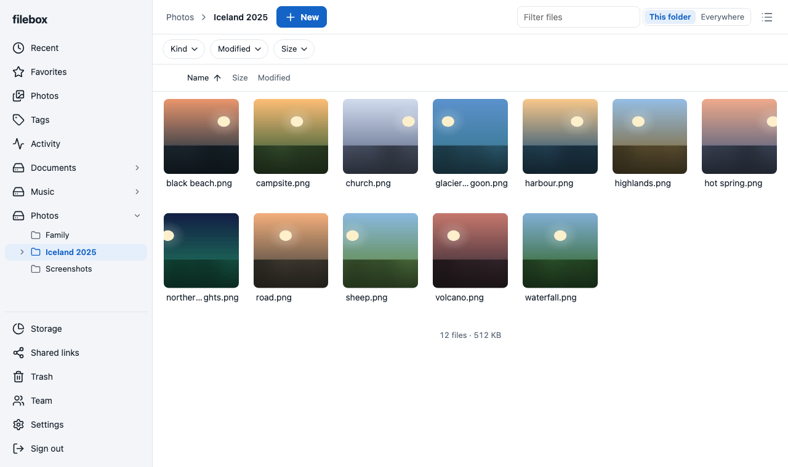

# filebox

A self-hosted file server in one binary. Browse, preview, upload and share files on local disks from a browser, a WebDAV client or the command line.



## Features

- **Files.** Resumable uploads over [tus](https://tus.io/protocols/resumable-upload), downloads with HTTP Range, WebDAV with per-device app passwords, zip and unzip, and a text editor in the browser.
- **Preview.** Images, video, audio, PDF, EPUB, comics, code and Markdown, and Word, Excel and PowerPoint through LibreOffice. Thumbnails and video streaming use ffmpeg when it is installed.
- **Find.** Search by name, path and the text inside documents. A photo timeline ordered by when each picture was taken, colored tags, recent files, a storage page, a duplicate finder, and a command palette on Ctrl/⌘+K.
- **Share.** Links with a password, an expiry and a download limit, and drop boxes that receive files from people without an account.
- **Keep.** A trash that holds deletes for 30 days, earlier versions of overwritten files, and a log of what changed.
- **Team.** Admins and members, access set per volume as none, read or read and write, and one-time invite links. A folder on screen updates by itself when someone else changes it.
- **Sign in.** Passwords, passkeys and app passwords, which can be read-only. Every session can be listed and ended.
- **Notify.** A bell for downloads and uploads through your links, new members and low disk space, and webhooks to ntfy, Gotify, Slack or your own endpoint.

The interface is in English and Chinese, and installs as an app on a phone.

## Quick start

With Docker, from a new folder:

```sh
curl -O https://raw.githubusercontent.com/m1ngsama/filebox/main/deploy/docker-compose.yml
# edit the volume paths and -origin, then make the first account and start it
echo 'your-password' | docker compose run --rm -T filebox passwd -data /data
docker compose up -d
```

Or with a [release build](docs/install.md):

```sh
echo 'your-password' | filebox passwd -data ./data
filebox serve -data ./data -vol files=$HOME/files
```

Open http://localhost:5280 and sign in as `admin`. Put filebox behind a reverse proxy that serves HTTPS before it faces the internet; [docs/running.md](docs/running.md) says how.

Database changes only go one way, so copy `filebox.db` before you update. Updating is always manual; see [docs/install.md](docs/install.md).

## Documentation

- [Install and update](docs/install.md): release builds and how to check them, Docker, a systemd unit, building from source.
- [Running filebox](docs/running.md): flags, a reverse proxy, passkeys, the trash and versions.
- [Team](docs/team.md): admins, members, per-volume access and invite links.
- [Search and duplicates](docs/search.md): what the search reads and what it costs on disk.
- [Notifications](docs/notifications.md): webhooks, formats and limits.
- [Command line](docs/command-line.md): WebDAV and resumable uploads with `curl`.
- [Releasing](RELEASING.md): how a version is made.

## Security

Report a vulnerability privately; [SECURITY.md](SECURITY.md) says how and what is in scope.

## License

[AGPL-3.0-or-later](LICENSE). The vendored [foliate-js](web/src/vendor/foliate/LICENSE) is MIT.
